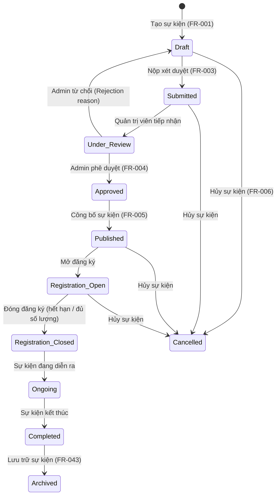
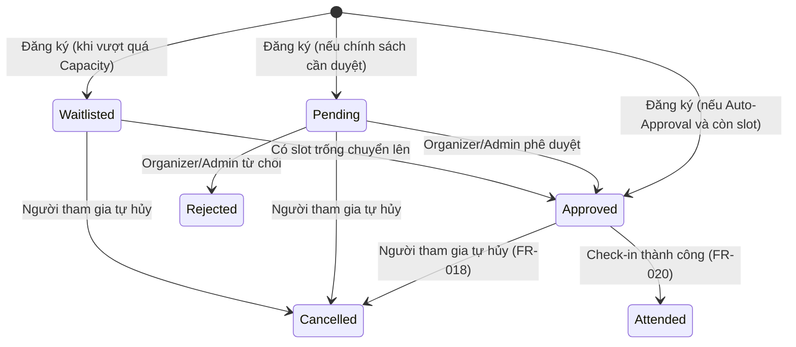
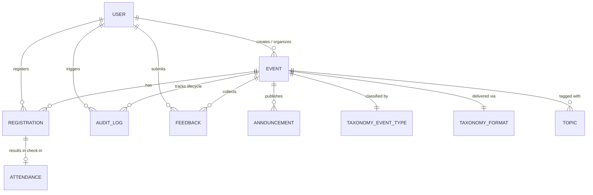

# AWS Event Management & Engagement Platform
> **Tài liệu Đặc tả Yêu cầu Kỹ thuật & Nghiệp vụ (SRS Summary & Implementation Guide)**  
> **Nguồn trích xuất**: `Lean Software Requirements Specific.txt` (v0.1)  
> **Phiên bản tài liệu**: 1.0  
> **Ngôn ngữ**: Tiếng Việt (chuyên môn kỹ thuật)

---

## 1. Tổng quan Dự án (Project Overview)

### 1.1 Mục đích (Purpose)
Xây dựng nền tảng quản lý và tương tác sự kiện tập trung, hướng kiến trúc **AWS-native**, dành riêng cho hệ sinh thái AWS. Nền tảng hợp nhất toàn bộ vòng đời sự kiện: từ tạo lập, phê duyệt, công bố, tìm kiếm, đăng ký, điểm danh, truyền thông, khảo sát cho đến phân tích dữ liệu.

### 1.2 Nguyên tắc cốt lõi (Core Principles)
* **System of Record (SoR)**: Nền tảng là nguồn dữ liệu chuẩn mực (**Canonical Source of Truth**) duy nhất cho tất cả sự kiện, lượt đăng ký, điểm danh và tương tác.
* **Độc lập nền tảng ngoài**: Giảm thiểu sự phân tán sang các dịch vụ bên thứ ba (Luma, Meetup, Eventbrite). Các dịch vụ này chỉ đóng vai trò kênh phụ, không kiểm soát luồng nghiệp vụ chính.
* **Canonical Event Model**: Mỗi sự kiện có mã định danh nội bộ (`Platform-Owned Event Identifier`), bảo toàn xuyên suốt lịch sử và tích hợp.

### 1.3 Mục tiêu kinh doanh (Business Objectives)
* **BO-001 (Adoption)**: Tăng độ phủ và mức độ sử dụng nền tảng làm kênh chính thức duy nhất để xuất bản sự kiện AWS.
* **BO-002 (Engagement)**: Tối ưu trải nghiệm khám phá, đăng ký tham gia và phản hồi sau sự kiện cho thành viên.
* **BO-003 (Platform Replacement)**: Cung cấp đầy đủ tính năng cốt lõi vượt trội nhằm thay thế dần các công cụ ngoài.

---

## 2. Phân quyền & Đối tượng Người dùng (User Roles & Personas)

| Vai trò | Phân loại | Quyền hạn chính |
| :--- | :--- | :--- |
| **AWS Admin** | System Admin | Toàn quyền quản trị hệ thống, phê duyệt/từ chối sự kiện, kiểm duyệt nội dung, quản lý taxonomy (danh mục), cấu hình chính sách, quản lý user/role, xem báo cáo phân tích toàn sàn và truy cập lịch sử kiểm toán (Audit Trail). |
| **Instructor** | Event Organizer | Tạo sự kiện ở dạng Draft, nộp xét duyệt, quản lý sự kiện do mình tạo, quản lý danh sách đăng ký, điểm danh (check-in), gửi thông báo/email cho người tham gia, xem phân tích sự kiện của mình. |
| **AWS Member** | Core Consumer | Khám phá, tìm kiếm & lọc sự kiện, đăng ký, hủy đăng ký, lưu/theo dõi (Save/Follow), nhận email/lịch hẹn/thông báo, check-in, gửi phản hồi/khảo sát sau sự kiện. |
| **AWS Intern** | Target Audience | Đối tượng người tham gia nội bộ, được phép khám phá và đăng ký các sự kiện phù hợp với quyền hạn. |
| **External Audience** | Optional Audience | Khán giả bên ngoài hệ sinh thái AWS; chỉ được phép tham gia khi sự kiện được người tổ chức kích hoạt tùy chọn riêng (`Allow External Participation`). |

---

## 3. Vòng đời Sự kiện & Đăng ký (State Machines)

### 3.1 Vòng đời Sự kiện (Event Lifecycle)

### 3.2 Vòng đời Đăng ký của Người tham gia (Registration Lifecycle)

---

## 4. Chi tiết Yêu cầu Chức năng (Functional Requirements - 44 FRs)

### 4.1 Quản lý Sự kiện (Event Management)
* **FR-001 (Create Event)**: Cho phép Instructor và Admin tạo sự kiện ở trạng thái `Draft`, tự động cấp phát ID duy nhất, áp dụng taxonomy hợp lệ.
* **FR-002 (Edit Event)**: Chỉnh sửa thông tin sự kiện dựa trên trạng thái vòng đời và quyền hạn (RBAC), bảo toàn Canonical ID.
* **FR-003 (Submit Event)**: Gửi sự kiện từ `Draft` lên `Submitted`/`Under Review`, kiểm tra đầy đủ các trường bắt buộc, lưu timestamp và người gửi.
* **FR-004 (Review Event)**: Admin duyệt (`Approve`) hoặc từ chối (`Reject` bắt buộc nhập lý do), lưu lịch sử reviewer.
* **FR-005 (Publish Event)**: Công bố sự kiện đã duyệt cho đối tượng mục tiêu khám phá.
* **FR-006 (Cancel Event)**: Hủy sự kiện từ các trạng thái hợp lệ, khóa đăng ký mới, lưu lý do và kích hoạt thông báo tới người đã đăng ký.
* **FR-007 (Manage Taxonomy)**: Áp dụng taxonomy chuẩn hóa:
  * Loại sự kiện: *Workshop, Training, Webinar, Tech Talk, Conference*.
  * Hình thức: *In-person, Online, Hybrid*.
  * Đối tượng: *AWS Members, AWS Interns, External Audience*.
  * Chủ đề (Governed Topics).
  * Chính sách đăng ký (Registration Policy).
* **FR-008 (Manage Lifecycle)**: Thực thi máy trạng thái chặt chẽ, từ chối chuyển trạng thái không hợp lệ, ghi log audit cho mỗi lần chuyển.
* **FR-042 (Centralized Admin Management)**: Bảng điều khiển tập trung cho Admin quản lý tất cả sự kiện qua mọi trạng thái (kể cả lịch sử), phân quyền truy cập nghiêm ngặt.
* **FR-043 (Historical Event Management)**: Quản lý, tìm kiếm, lọc các sự kiện lịch sử (`Completed`, `Cancelled`, `Archived`), không xóa dữ liệu vật lý.
* **FR-044 (Event Audit Timeline)**: Hiển thị dòng thời gian kiểm toán theo thứ tự thời gian (ai làm gì, thời điểm nào, lý do gì), bảo vệ không cho chỉnh sửa/xóa log.

### 4.2 Khám phá & Tìm kiếm (Event Discovery)
* **FR-009 (Browse Published Events)**: Người dùng xem các sự kiện đã công bố phù hợp với nhóm đối tượng của mình (ẩn sự kiện đã hủy/lưu trữ đối với người dùng phổ thông).
* **FR-010 (Search Events)**: Tìm kiếm full-text theo tên, mô tả, diễn giả.
* **FR-011 (Filter Events)**: Bộ lọc đa chiều: Loại sự kiện, hình thức tổ chức, chủ đề, nhóm đối tượng, khoảng thời gian, tình trạng chỗ trống.
* **FR-012 (View Event Details)**: Trang chi tiết sự kiện hiển thị đầy đủ thông tin nội dung, diễn giả, lịch trình, địa điểm/link họp, chính sách đăng ký.
* **FR-013 (Save / Follow Event)**: Người dùng đã đăng nhập có thể đánh dấu lưu/theo dõi sự kiện quan tâm.

### 4.3 Đăng ký & Điểm danh (Registration & Capacity)
* **FR-014 (Register for Event)**: Đăng ký trực tiếp trên nền tảng, ngăn chặn đăng ký trùng lặp (`Duplicate Active Registration`).
* **FR-015 (Registration Statuses)**: Quản lý 6 trạng thái đăng ký: `Pending`, `Approved`, `Waitlisted`, `Rejected`, `Cancelled`, `Attended`.
* **FR-016 (Manage Capacity)**: Quản lý giới hạn số lượng tham gia; khi hết chỗ tự động chuyển sang Waitlist hoặc đóng đăng ký.
* **FR-017 (Approval Policies)**: Cung cấp 4 chính sách:
  1. *Auto Approval*: Tự động duyệt ngay khi còn chỗ.
  2. *Manual Approval*: Cần người tổ chức xác nhận thủ công.
  3. *Invite Only*: Chỉ dành cho người có lời mời.
  4. *Capacity with Waitlist*: Hết chỗ tự động vào danh sách chờ.
* **FR-018 (Cancel Registration)**: Người tham gia tự hủy đăng ký trước hạn; giải phóng slot cho người trong Waitlist.
* **FR-019 (Manage Registrations)**: Ban tổ chức quản lý danh sách đăng ký (duyệt, từ chối, xuất danh sách).
* **FR-020 (Check In Participant)**: Điểm danh người tham gia (ghi nhận thời gian và người thực hiện check-in), phục vụ phân tích tỷ lệ tham gia thực tế.
* **FR-021 (Paid Events Exclusion)**: Hiện tại **không** hỗ trợ sự kiện trả phí, không tích hợp cổng thanh toán.

### 4.4 Tương tác & Truyền thông (Engagement)
* **FR-022 (Registration Confirmation)**: Gửi thông báo/email xác nhận ngay sau khi đăng ký hoặc khi được duyệt.
* **FR-023 (Calendar Invitation)**: Cung cấp file lịch `.ics` hoặc tích hợp Google Calendar/Outlook cho người được duyệt.
* **FR-024 (Send Reminders)**: Tự động gửi thông báo nhắc lịch trước thời điểm diễn ra sự kiện.
* **FR-025 (Publish Announcements)**: Người tổ chức đăng thông báo cập nhật tới người tham gia sự kiện.
* **FR-026 (Send Email Communication)**: Gửi email liên lạc trực tiếp tới người tham gia theo bộ lọc trạng thái.
* **FR-027 (Deliver Notifications)**: Hệ thống thông báo In-app và Email cho các thay đổi quan trọng.
* **FR-028 (Post-Event Feedback)**: Thu thập khảo sát/đánh giá (Survey/Feedback) sau khi sự kiện hoàn thành, gán chặt với dữ liệu người tham gia và sự kiện.

### 4.5 Phân tích & Báo cáo (Analytics)
* **FR-029 (Event-Level Analytics)**: Thống kê cấp sự kiện: Lượt xem, lượt đăng ký, tỷ lệ duyệt/từ chối, số lượng check-in thực tế, no-show rate, điểm đánh giá trung bình.
* **FR-030 (Platform-Level Analytics)**: Báo cáo cấp hệ thống cho Admin: Tốc độ tăng trưởng thành viên, chủ đề được quan tâm nhiều nhất, tỷ lệ giảm tải phụ thuộc vào nền tảng ngoài.
* **FR-031 (Analytics Extensibility)**: Kiến trúc schema mở để sau này bổ sung pipeline phân tích (như Amazon QuickSight, Athena) mà không cần đổi mô hình gốc.

### 4.6 Quyền sở hữu Dữ liệu & Tích hợp (Data Ownership & Integration)
* **FR-032 (Maintain Canonical Data)**: Toàn bộ dữ liệu sự kiện, đăng ký, điểm danh là tài sản chuẩn của nền tảng.
* **FR-033 (Platform-Owned Identifiers)**: Sử dụng UUID/CUID riêng của hệ thống; mã ID từ nền tảng khác chỉ lưu dưới dạng metadata tham chiếu.
* **FR-034 & FR-035 (External Platform Isolation)**: Luma/Meetup/Eventbrite không được phép can thiệp vào luồng chính; không chuyển hướng người dùng ra ngoài để đăng ký.
* **FR-036 (Future Migration Support)**: Có sẵn cấu trúc để nhập (import/migrate) dữ liệu sự kiện cũ từ file hoặc API bên thứ ba.

### 4.7 Quản trị & Tuân thủ (Governance & Administration)
* **FR-037 (Manage Users and Roles)**: Quản lý người dùng, gán vai trò (`AWS Admin`, `Instructor`, `AWS Member`, `AWS Intern`).
* **FR-038 (Manage Taxonomy)**: CRUD các giá trị danh mục: Loại sự kiện, Format, Đối tượng, Chủ đề.
* **FR-039 (Configure Event Policies)**: Thiết lập các cấu hình chính sách mặc định của nền tảng.
* **FR-040 (Moderate Event Content)**: Kiểm duyệt nội dung sự kiện, gỡ bỏ hoặc tạm dừng các sự kiện vi phạm quy định.
* **FR-041 (Audit Governance Actions)**: Ghi nhật ký bất biến (Immutable Audit Log) cho tất cả các thao tác quản trị nhạy cảm.

---

## 5. Quy tắc Nghiệp vụ Trọng yếu (Business Rules)

| Mã quy tắc | Tên quy tắc | Nội dung bắt buộc tuân thủ |
| :--- | :--- | :--- |
| **BR-001** | System of Record | Nền tảng là nguồn dữ liệu chuẩn mực tối cao cho dữ liệu sự kiện và vòng đời sự kiện. |
| **BR-002** | External Participation Policy | Mặc định đối tượng chỉ là nội bộ; người tổ chức phải bật cờ cho phép bên ngoài một cách tường minh mới được mở cho khách ngoài. |
| **BR-003** | Governed Taxonomy | Người tạo sự kiện chỉ được chọn danh mục có sẵn do Admin quy định, không được tự ý tạo taxonomy tự do. |
| **BR-004** | Internal Registration Only | Đăng ký bắt buộc diễn ra trên nền tảng; tuyệt đối không redirect người dùng sang Luma/Eventbrite để đăng ký. |
| **BR-005** | Capacity Enforcement | Nếu sự kiện có giới hạn chỗ, hệ thống phải chặn đăng ký khi đầy và kích hoạt luồng Waitlist/đóng đăng ký. |
| **BR-006** | Mandatory Review Workflow | Mọi sự kiện do Instructor tạo phải qua bước duyệt của Admin trước khi được Publish ra ngoài. |
| **BR-007** | No Third-party Dependency | Mọi chức năng cốt lõi (tạo, duyệt, đăng ký, điểm danh) phải hoạt động độc lập không phụ thuộc API bên thứ ba. |
| **BR-008** | Free-by-Default | Toàn bộ sự kiện được mặc định là miễn phí tham gia. |
| **BR-009** | Role vs Audience Separation | Phân biệt rõ giữa vai trò người dùng trong hệ thống (System Role: Admin/Instructor/Member) và nhóm đối tượng mục tiêu của sự kiện (Target Audience). |
| **BR-010** | Canonical Attendance Tracking | Dữ liệu điểm danh phải lưu trực tiếp vào bản ghi đăng ký thuộc sở hữu nền tảng. |
| **BR-011** | Centralized Admin Oversight | Giao diện quản trị phải cho phép Admin xem cả sự kiện hiện tại lẫn sự kiện trong quá khứ. |
| **BR-012** | Soft Lifecycle Preservation | Sự kiện `Completed`, `Cancelled`, `Archived` không được xóa vật lý (No hard deletion) nhằm bảo toàn dữ liệu lịch sử. |
| **BR-013** | Traceable Auditability | Mọi chuyển đổi trạng thái và hành động quản trị quan trọng phải gắn liền với Event ID, Actor, Timestamp và Reason. |

---

## 6. Mô hình Thực thể Dữ liệu (Core Entity Model)

### Các trường dữ liệu cốt lõi dự kiến
1. **User**: `id`, `name`, `email`, `role (ADMIN | INSTRUCTOR | MEMBER | INTERN)`, `avatarUrl`, `createdAt`
2. **Event**: `id`, `slug`, `title`, `description`, `eventTypeId`, `deliveryFormat (IN_PERSON | ONLINE | HYBRID)`, `targetAudiences`, `locationOrUrl`, `startTime`, `endTime`, `capacity`, `registrationPolicy (AUTO | MANUAL | INVITE_ONLY | WAITLIST)`, `status (DRAFT | SUBMITTED | UNDER_REVIEW | APPROVED | PUBLISHED | REGISTRATION_OPEN | REGISTRATION_CLOSED | ONGOING | COMPLETED | CANCELLED | ARCHIVED)`, `organizerId`, `createdAt`, `updatedAt`
3. **Registration**: `id`, `eventId`, `userId`, `status (PENDING | APPROVED | WAITLISTED | REJECTED | CANCELLED | ATTENDED)`, `registeredAt`, `cancelledAt`
4. **Attendance**: `id`, `registrationId`, `eventId`, `checkedInAt`, `checkedInBy`
5. **EventAuditLog**: `id`, `eventId`, `action`, `actorId`, `previousState`, `newState`, `reason`, `createdAt`
6. **Feedback**: `id`, `eventId`, `userId`, `rating (1-5)`, `comments`, `createdAt`
7. **Announcement**: `id`, `eventId`, `title`, `content`, `authorId`, `publishedAt`

---

## 7. Yêu cầu Phi chức năng & Kiến trúc Kỹ thuật (NFRs & Tech Stack)

### 7.1 Yêu cầu chất lượng (NFRs)
* **NFR-001 (Scalability)**: Hỗ trợ lượng người dùng và số lượng sự kiện mở rộng mà không cần thiết kế lại mô hình dữ liệu.
* **NFR-003 (Security & RBAC)**: Bảo mật dữ liệu người tham gia, phân quyền dựa trên vai trò nghiêm ngặt giữa Admin, Instructor và Member.
* **NFR-004 & NFR-005 (Integrity & Observability)**: Toàn vẹn dữ liệu, ghi log, giám sát tập trung phục vụ vận hành.
* **NFR-008 & NFR-009 (Usability & Accessibility)**: Giao diện trực quan, đạt chuẩn tiện dụng và trợ năng theo tiêu chuẩn hiện đại.

### 7.2 Hướng Kiến trúc Ứng dụng (Application Stack)
Theo định hướng của dự án hiện tại trên repository:
* **Frontend / Full-stack**: **Next.js 16 (App Router)** + **React 19** + **TypeScript**.
* **Styling**: **Tailwind CSS v4** kết hợp thiết kế UI hiện đại, thẩm mỹ cao (Dark/Light mode, Glassmorphism, Micro-animations).
* **Kiến trúc Server**: Server Actions / Route Handlers cho các nghiệp vụ kiểm soát logic, bảo đảm validation chặt chẽ.
* **AWS Services tích hợp tiềm năng**:
  * **Auth**: AWS Cognito hoặc NextAuth/Lucia gắn với IAM/Directory.
  * **Database**: Amazon Aurora Serverless (PostgreSQL) hoặc DynamoDB (Single Table Design).
  * **Storage**: Amazon S3 (lưu banner, tài liệu sự kiện).
  * **Notifications & Email**: Amazon SES + Amazon SNS/EventBridge.
  * **Compute & Hosting**: AWS Amplify / ECS Fargate hoặc Serverless Lambda.

---

## 8. Các vấn đề còn mở (Open Decisions cần chốt)

1. **Bypass Approval**: Admin có được phép bỏ qua bước kiểm duyệt để đăng bài ngay lập tức khi tạo sự kiện hay không?
2. **Chi tiết Taxonomy**: Danh mục chi tiết các chủ đề (Topics) và định dạng chuẩn ban đầu của hệ sinh thái AWS.
3. **Provider Xác thực (IdP)**: Sử dụng AWS Cognito nội bộ hay tích hợp SSO với nhà cung cấp danh tính nào của AWS.
4. **Cơ chế xác thực khán giả bên ngoài (External Audience)**: Sử dụng OTP qua email, Magic Link hay tài khoản Guest.
5. **Kênh thông báo mở rộng**: Ngoài Email và In-app, có tích hợp Slack/Discord/Chime webhook hay SMS không.

---

## 9. Lộ trình Triển khai Đề xuất (Suggested Implementation Phases)

* **Phase 1: Foundation & Data Modeling**
  * Thiết lập schema cơ sở dữ liệu (User, Event, Registration, AuditLog, Taxonomy).
  * Xây dựng hệ thống Mock Data / Database Client và Seed dữ liệu chuẩn.
* **Phase 2: Event Management & Governance (Admin & Instructor Portal)**
  * Giao diện tạo sự kiện (Draft) với form chuẩn hóa taxonomy.
  * Luồng gửi duyệt (Submit) và Admin Dashboard để duyệt/từ chối (Approve/Reject).
  * Trang quản lý tập trung và dòng thời gian kiểm toán (`Audit Timeline` - FR-042, FR-044).
* **Phase 3: Member Portal & Discovery**
  * Trang chủ danh sách sự kiện (Grid/Card view thẩm mỹ cao).
  * Tính năng Tìm kiếm full-text và Bộ lọc đa chiều (Filter bar).
  * Trang chi tiết sự kiện (`Event Details View`) và chức năng Lưu (`Save/Follow`).
* **Phase 4: Registration, Capacity & Check-in**
  * Xử lý luồng đăng ký (Auto vs Manual Approval).
  * Xử lý Capacity, Waitlist tự động và hủy đăng ký.
  * Giao diện điểm danh (`Check-in Desk`) cho Instructor.
* **Phase 5: Engagement & Analytics Dashboard**
  * Xuất file lịch `.ics` và hệ thống thông báo sự kiện.
  * Form khảo sát và gửi phản hồi sau sự kiện (Post-event feedback).
  * Dashboard thống kê và phân tích trực quan cho Admin và Organizer.
